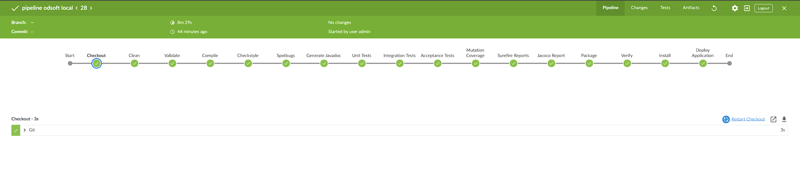
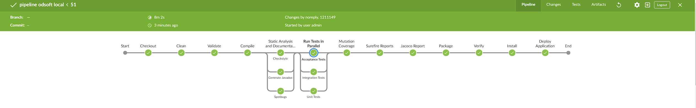
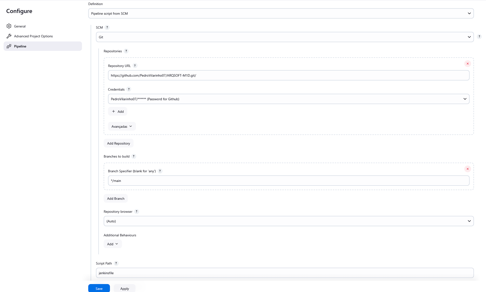

# ODSOFT TP1 - Análise da Pipeline e Jenkins



### 1. Checkout
- **Descrição**: Realiza o checkout do repositório especificado no GitHub utilizando credenciais fornecidas.
- **Logs Relevantes**:
    - `Selected Git installation does not exist. Using Default` indica que nenhuma instalação específica do Git foi configurada, sendo usado o cliente padrão.
    - `The recommended git tool is: NONE` sugere que a configuração recomendada para o Git no Jenkins precisa ser ajustada.
    - O commit carregado (`b92bb49d14e30c948c87b00886b672b8ddcf6165`) possui a mensagem: `"acceptance test working and pom dependencies added"`.

---

### 2. Clean
- **Descrição**: Remove arquivos gerados em builds anteriores.
- **Logs Relevantes**:
    - Problemas no `pom.xml`: Há duplicações do plugin `maven-surefire-plugin` nas linhas 273 e 281.
    - `BUILD SUCCESS` confirma a conclusão bem-sucedida da etapa.

---

### 3. Validate
- **Descrição**: Valida a estrutura do projeto e dependências no `pom.xml`.
- **Logs Relevantes**:
    - Os mesmos problemas de duplicação do `maven-surefire-plugin` persistem.
    - `BUILD SUCCESS` indica que, apesar dos avisos, o projeto foi validado corretamente.

---

### 4. Compile
- **Descrição**: Compila o código-fonte para garantir que ele está livre de erros.
- **Logs Relevantes**:
    - Foram detectados **avisos sobre propriedades não mapeadas** e métodos duplicados:
        - Exemplo: `Unmapped target property: "enabled"` no `EditUserMapper.java`.
        - `Not generating getTitle(): A method with that name already exists`.
    - `BUILD SUCCESS` indica que o código foi compilado com sucesso.

---

### 5. Checkstyle
- **Descrição**: Verifica o estilo do código em relação às regras configuradas.
- **Logs Relevantes**:
    - Foram detectados **4027 erros de estilo** com base no `sun_checks.xml`. Corrigir essas violações é essencial para melhorar a legibilidade e a manutenção do código.

---

### 6. SpotBugs
- **Descrição**: Analisa o código em busca de bugs potenciais.
- **Logs Relevantes**:
    - Nenhum problema crítico identificado.
    - As advertências sobre duplicação do plugin no `pom.xml` aparecem novamente.

---

### 7. Generate Javadoc
- **Descrição**: Gera a documentação do código-fonte.
- **Logs Relevantes**:
    - Diversos avisos sobre a **falta de comentários** em classes, métodos e parâmetros:
        - Exemplo: `No comment` no método `public OpenAPI openApi()` em `ApiConfig.java`.

---

### 8. Unit Tests
- **Descrição**: Executa os testes unitários para validar funcionalidades isoladas.
- **Logs Relevantes**:
    - Todos os testes passaram com sucesso:
        - `Tests run: 3, Failures: 0, Errors: 0, Skipped: 0`.
    - Nenhuma falha foi encontrada.

---

### 9. Integration Tests
- **Descrição**: Valida a integração entre os diferentes componentes do sistema.
- **Logs Relevantes**:
    - Nenhum teste de integração foi executado:
        - `Tests run: 0, Failures: 0, Errors: 0, Skipped: 0`.

---

### 10. Acceptance Tests
- **Descrição**: Testa os requisitos funcionais do sistema.
- **Logs Relevantes**:
    - Os testes passaram:
        - `Tests run: 3, Failures: 0, Errors: 0, Skipped: 0`.
    - Foi detectado um problema na criação da tabela `author`:
        - `"Syntax error in SQL statement 'create table author (pk bigint identity not null, author_number ... )'"`.
        - Indica um **erro de sintaxe SQL**, possivelmente relacionado ao uso de `identity` como palavra-chave reservada.

---

### 11. Mutation Coverage
- **Descrição**: Mede a cobertura dos testes em cenários simulados.
- **Logs**: Não fornecidos.

---

### 12. Surefire Reports
- **Descrição**: Gera relatórios detalhados dos testes unitários.
- **Logs**: Não fornecidos.

---

### 13. Jacoco Report
- **Descrição**: Analisa e apresenta a cobertura do código pelos testes.
- **Logs**: Não fornecidos.

---

### 14. Package
- **Descrição**: Empacota a aplicação em um arquivo `.jar` ou `.war`.
- **Logs**: Não fornecidos.

---

### 15. Verify
- **Descrição**: Verifica o pacote antes da instalação.
- **Logs**: Não fornecidos.

---

### 16. Install
- **Descrição**: Instala o pacote localmente.
- **Logs**: Não fornecidos.

---

### 17. Deploy Application
- **Descrição**: Implementa a aplicação num ambiente configurado.
- **Logs**: Não fornecidos.

---

## Problemas Identificados e Soluções de melhoria da Pipeline
1. **Duplicação do Plugin no `pom.xml`**:
    - Aparece em várias etapas (clean, validate, etc.).
    - **Solução**: Remover declarações duplicadas do `maven-surefire-plugin`.

2. **Erros de Estilo no Código**:
    - Foram identificados mais de 4000 erros.
    - **Solução**: Adotar um padrão de formatação e corrigir as violações.

3. **Avisos sobre Propriedades Não Mapeadas**:
    - Afetam a qualidade do código.
    - **Solução**: Ajustar os mapeamentos para incluir todas as propriedades.

4. **Falta de Comentários no Código**:
    - A ausência de documentação reduz a manutenibilidade.
    - **Solução**: Adicionar comentários descritivos às classes, métodos e parâmetros.


# Análise do Jenkinsfile com Testes e Análises em Paralelo

## Destaques do Jenkinsfile
O Jenkinsfile apresentado organiza eficientemente as etapas da pipeline, incluindo a execução de testes e análises de código em paralelo. Esta abordagem traz diversos benefícios relacionados à eficiência e qualidade do desenvolvimento, ao mesmo tempo que mantém um foco claro nos objetivos de cada etapa.

---

## 1. Execução de Testes em Paralelo



### Objetivo
**Reduzir o tempo total de execução da pipeline.**
- A execução simultânea dos testes (unitários, de integração e de aceitação) permite obter resultados mais rapidamente em comparação ao formato sequencial.
- Cada tipo de teste é independente e pode ser processado em agentes ou threads separados, garantindo validação eficiente e simultânea de diferentes aspectos do sistema.
- O feedback mais rápido melhora o ciclo de desenvolvimento, permitindo que problemas sejam detetados e corrigidos com maior agilidade.


### Estágios de Testes em Paralelo
- **Unit Tests**:
    - Valida funcionalidades individuais do sistema de forma isolada.
    - Detecta erros em blocos específicos de código, como métodos ou classes, sem dependência de outros componentes.

- **Integration Tests**:
    - Garante que diferentes módulos do sistema funcionem bem juntos.
    - Valida a comunicação e integração entre componentes, como APIs e bancos de dados.

- **Acceptance Tests**:
    - Verifica se o sistema atende aos requisitos funcionais.
    - Avalia o comportamento do sistema do ponto de vista do usuário final.


# Comparação de Resultados: Execução de Testes com e sem Paralelismo

## 1. Testes Unitários

### Sem paralelismo:
- **Tempo total:** **22.606 segundos**
- **Execução linear:** os testes foram executados sequencialmente, respeitando a ordem de dependência dos módulos.

### Com paralelismo:
- **Tempo total:** **14.400 segundos**
- **Execução:** a configuração em paralelo resultou em uma execução mais rápida devido à divisão eficiente das tarefas entre os recursos disponíveis.

**Observação:** A redução no tempo reflete a eficiência do paralelismo para os testes unitários, mostrando que as dependências compartilhadas foram bem gerenciadas.

---

## 2. Testes de Aceitação

### Sem paralelismo:
- **Tempo total:** **33.861 segundos**
- **Execução:** inicialização e execução sequencial de todas as dependências do Spring Context e dos testes.

### Com paralelismo:
- **Tempo total:** **26.721 segundos**
- **Execução:** a execução paralela foi mais eficiente, reduzindo o tempo total necessário para concluir os testes.

**Observação:** Apesar do uso de recursos compartilhados como o banco de dados H2, o paralelismo demonstrou ser vantajoso, reduzindo o tempo de execução para os testes de aceitação.

---

Essa comparação evidencia os ganhos potenciais do paralelismo, especialmente em cenários de testes unitários e de aceitação.


### Benefícios do Paralelismo
- **Redução do Tempo Total**: Executar testes simultaneamente reduz a espera para resultados, acelerando ciclos de feedback e desenvolvimento.
- **Maior Utilização de Recursos**: O paralelismo aproveita ao máximo os recursos disponíveis no ambiente de execução (como núcleos de CPU ou máquinas virtuais).
- **Melhoria na Eficiência da Pipeline**: Etapas críticas podem ser concluídas rapidamente, permitindo que desenvolvedores foquem em melhorias e correções.


---

## 2. Static Analysis and Documentation
O estágio **Static Analysis and Documentation** é organizado em três subestágios paralelos: **Checkstyle**, **Spotbugs** e **Generate Javadoc**. Cada subestágio tem objetivos específicos e contribui de forma única para a qualidade do código.

### Checkstyle
- **Objetivo**: Verificar o código contra um conjunto predefinido de regras de estilo.
- **Impacto**:
    - Garante consistência no formato e estrutura do código.
    - Melhora a legibilidade e facilita a manutenção por equipes.
- **Benefício na Pipeline**: Detecta erros de estilo automaticamente, reduzindo revisões manuais.

### Spotbugs
- **Objetivo**: Identificar bugs potenciais no código.
- **Impacto**:
    - Detecta problemas como vulnerabilidades de segurança e falhas de desempenho.
    - Foca em análise estática para prevenir problemas antes da execução.
- **Benefício na Pipeline**: Reduz o risco de problemas críticos atingirem ambientes de produção.

### Generate Javadoc
- **Objetivo**: Gerar documentação do código automaticamente.
- **Impacto**:
    - Produz documentação padronizada e acessível para desenvolvedores.
    - Facilita a integração de novos membros na equipe e a reutilização de componentes.
- **Benefício na Pipeline**: Garante que a documentação esteja atualizada e pronta para ser utilizada.


# Outros - Testes

# Explicação de Testes de Software

## **1. Testes Unitários**
Testes unitários verificam o funcionamento de partes isoladas do código, como métodos ou classes. Eles garantem que cada unidade do sistema funcione conforme esperado de forma independente.

### **Caixa Transparente**

  Neste tipo de teste, temos conhecimento sobre a implementação interna do método ou classe. Testamos diretamente como a unidade se comporta internamente, verificando chamadas de métodos, interações entre objetos ou verificações explícitas de lógica.

- **Exemplo**:
  ```java
  @Test
  void setNameTransparentTest() {
      String newName = "newName";
      authorSpy.setName(newName);
      verify(doubleNameFactory, times(1)).newName(newName);
  }
  ```
    - **O que é testado?**:
        1. Se a fábrica de nomes (`doubleNameFactory`) foi chamada exatamente uma vez.
        2. Se o novo nome (`newName`) foi passado corretamente para a fábrica.

- Este teste garante que o método foi implementado corretamente e que as interações internas funcionam como esperado.

### **Caixa Opaca**

  Aqui, testamos a funcionalidade da unidade sem conhecimento sobre sua implementação interna. Focamos nas entradas fornecidas ao método e nas saídas ou comportamentos esperados.

- **Exemplo**:
  ```java
  @Test
  public void ensureAuthorNumberMustNotBeNullTest() {
      String expectedMessage = "Author Number cannot be null";
      Exception exception = assertThrows(IllegalArgumentException.class, () -> new AuthorNumber(null));
      assertTrue(exception.getMessage().contains(expectedMessage));
  }
  ```
    - **O que é testado?**:
        1. Se o construtor de `AuthorNumber` lança uma exceção ao receber uma entrada inválida (`null`).
        2. Se a mensagem de erro gerada corresponde à esperada.

- Este teste foca no comportamento observável da classe, ignorando a lógica interna que causa o erro.

---

## **2. Testes de Integração**
Testes de integração verificam se diferentes componentes do sistema trabalham bem juntos. O foco está na interação entre módulos, como repositórios, serviços, controladores e o banco de dados.

- **Exemplo**:
  ```java
  @Test
  @DisplayName("Should create a new author")
  @WithMockUser(username = "librarian@email.pt", authorities = { "ROLE_LIBRARIAN" })
  void createAuthor() throws Exception {
      CreateAuthorRequest request = new CreateAuthorRequest();
      request.setName("John Doe");
      request.setBio("An accomplished author of various novels.");
      mockMvc.perform(post("/api/authors")
                      .contentType(MediaType.APPLICATION_JSON)
                      .content(objectMapper.writeValueAsString(request)))
              .andExpect(status().isCreated())
              .andExpect(jsonPath("$.name").value("John Doe"))
              .andExpect(jsonPath("$.bio").value("An accomplished author of various novels."));
  }
  ```

- **O que é feito?**
    1. Simula-se uma requisição HTTP `POST` para o endpoint `/api/authors` com os dados do autor.
    2. Verifica-se:
        - O status da resposta (esperado: `201 Created`).
        - Os dados retornados no JSON, como nome (`John Doe`) e biografia (`An accomplished author of various novels`).

  Este teste garante que o endpoint HTTP funciona corretamente e interage bem com os componentes internos, como serviços e repositórios.

---

## **3. Testes de Aceitação**
Os testes de aceitação validam que o sistema atende aos requisitos do cliente ou usuário final. Eles simulam cenários reais de uso.

- **Exemplo**:
  ```java
  @Test
  @WithMockUser(username = "reader@email.pt", authorities = { "ROLE_READER" })
  public void whenGetAuthorByAuthorNumber_thenReturnAuthorDetails() throws Exception {
      mockMvc.perform(get("/api/authors/" + author.getAuthorNumber())
                      .contentType(MediaType.APPLICATION_JSON))
              .andExpect(status().isOk())
              .andExpect(jsonPath("$.name").value("Madalena Fernandes"))
              .andExpect(jsonPath("$.bio").value("Excelente Cronista"));
  }
  ```

- **O que é feito?**
    1. Um endpoint HTTP `GET` (`/api/authors/{authorNumber}`) é chamado.
    2. Valida-se:
        - O status da resposta (`200 OK`).
        - Os dados retornados, como nome (`Madalena Fernandes`) e biografia (`Excelente Cronista`).


  Este teste simula o uso real do sistema por um cliente e garante que o sistema responde corretamente às solicitações e atende aos requisitos esperados.

---

# Webhook GitHub Hook Trigger for GITScm Polling

### **Objetivo**
Automatizar o disparo de builds no Jenkins sempre que ocorrerem alterações num repositório do GitHub.

1. **Webhook no GitHub**:
    - Configurado para notificar o Jenkins sobre eventos como push ou pull request.
2. **Jenkins**:
    - Recebe a notificação e dispara a build automaticamente.


### **Benefícios**
- **Automação**: Builds iniciadas imediatamente após mudanças no código.
- **Eficiência**: Evita polling contínuo e reduz o uso de recursos.
- **Feedback Rápido**: Desenvolvedores recebem notificações de erros ou sucesso rapidamente.

### **Resumo**
Facilita a integração contínua (CI) ao conectar o GitHub e o Jenkins de forma eficiente, eliminando a necessidade de verificações periódicas e acelerando o pipeline de desenvolvimento.
